<!-- Perfil de GitHub de Nubyron: repositorio público github.com/Nubyron/Nubyron (con la carpeta assets/ al lado).
     La fuente está en la oficina: marketing/github. Los SVG los genera un script: pedir cambios a Consultor Claude. -->

<picture>
  <source media="(prefers-color-scheme: dark)" srcset="assets/nubyron-logo-300x75-white.png">
  <source media="(prefers-color-scheme: light)" srcset="assets/nubyron-logo-300x75-negro.png">
  
</picture>


<picture><source media="(max-width: 600px)" srcset="assets/m-stats.svg">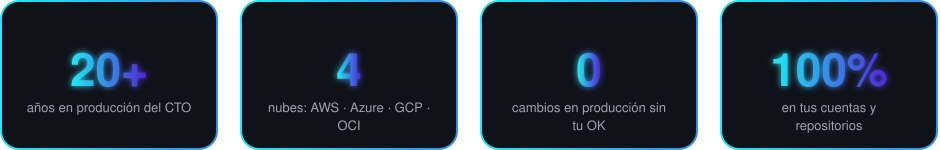</picture>

  

<picture><source media="(max-width: 600px)" srcset="assets/m-terminal.svg"></picture>

 


  <picture><source media="(max-width: 600px)" srcset="assets/m-como-trabajamos.svg">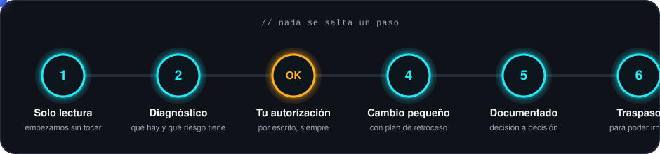</picture>

Trabajamos en **tus cuentas y tus repositorios**. Empezamos en solo lectura, cambiamos producción solo con tu autorización por escrito y lo dejamos todo documentado para poder irnos.

Revisión, arquitectura, costes, seguridad, migración, soporte y DevOps en **AWS, Azure, Google Cloud y OCI**, trabajando siempre en tus propias cuentas.

  <a href="https://nubyron.com/es"><picture><source media="(max-width: 600px)" srcset="assets/m-servicios.svg"></picture></a>

 


  <picture><source media="(max-width: 600px)" srcset="assets/m-kubectl.svg"></picture>

Ejemplo ilustrativo: así queremos que se vea tu producción un lunes por la mañana.

 


  <picture><source media="(max-width: 600px)" srcset="assets/m-stack.svg"></picture>

 


  <picture><source media="(max-width: 600px)" srcset="assets/m-equipo.svg"></picture>

 


  <picture><source media="(max-width: 600px)" srcset="assets/m-partners.svg"></picture>

Usamos **KubeBolt** en nuestro día a día con Kubernetes y somos *design partners*: ayudamos a darle forma desde la operación real.


Aún estamos preparando lo que compartiremos aquí. Cuando publiquemos algo será reutilizable y sin datos de clientes.

 

<a href="https://nubyron.com/es/reunion"><picture><source media="(max-width: 600px)" srcset="assets/m-cta.svg"></picture></a>

Hecho desde Las Palmas de Gran Canaria · Tecnología con criterio

